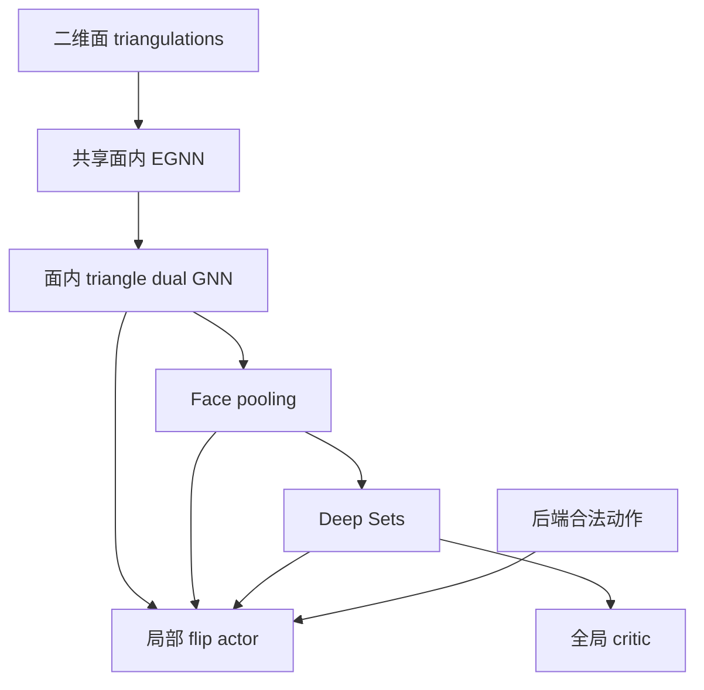

# TriSearch Calabi Yau 二维面模型修改计划

这次修改的目标是：让 actor 和 critic 只依赖带有面归属的 two-face triangulations，同时继续使用现有的 CYTools 邻居生成、Kcup evaluator、managed runtime 和 PPO。

第一版采用 **共享面内 EGNN → triangle dual GNN → Deep Sets → 局部 flip actor 与全局 critic**，注册为新的 `two_face_deep_sets` 模型。现有 `snn_simplex` 保留为对照。模型切换、搜索去重、探索计数分别配置，避免一次实验同时改变多个因素。

当前整合版本保留本文的原始结构为 `--two_face_encoder triangle_dual`，其层数由
`--two_face_triangle_layers` 指定，默认 2。简化结构 `deep_sets` 跳过 triangle dual
消息层，是新训练的默认编码器；历史 checkpoint 省略 flag 时按 sidecar 自动识别。
编码器与 `--training_reward_mode` 独立，两种结构均支持 step 和 best_so_far 奖励。
当前用法及复现材料见 [README](README.md)。下文保留原设计方案及其研究假设。

代码基准为 [IanWangg/TriSearch-Calabi-Yau 的 master 提交 eda14ae](https://github.com/IanWangg/TriSearch-Calabi-Yau/tree/eda14ae9a8bd3cfaeedbf4db9fdeb9cead6444fa)。以下新文件、字段和配置是拟新增接口。

## 1 当前代码已经具备的基础

| 模块 | 当前行为 | 本次处理 |
| --- | --- | --- |
| `mdp/cy_geometry_worker.py::_expand` | 调用 `neighbor_triangulations(two_neighbors=True)`；动作是四点 circuit；保存完整 representative 的 simplex 差分 | 复用邻居与 transition，不重写可延拓性求解 |
| `mdp/cy_state_record.py` | 已有 `two_face_state_key`、`configuration.two_face_labels` 和 `state.two_face_key` | 提取共享的结构化 face restrictions，供 key 与 observation 共用 |
| `core/cy_data_utils.py::create_data_from_cy_state_with_subcomplex` | 输入 `state.vertices`、完整 `state.edges`，可附加完整 `state.simplices` 的 topology | 为新模型增加独立的 two-face builder |
| `models/egnn_subcomplex_predictor.py::EGNNSubcomplexAgent` | 默认 `snn_simplex`：全图 EGNN 后，在 maximal simplices 上运行 SNN；critic 池化 simplex features | 新增独立 agent，保留已有 agent |
| `core/snn_simplex_topology.py` | 由完整 simplices 构造 down Laplacian；四点动作可通过 overlap 匹配高维 cofaces | 新模型显式编码所在面的两个 removed triangles |
| `core/cy_ppo.py` | rollout 保存 CPU Data，PPO 重用 observation；已有 GAE、clipping 和分块训练 | 复用学习算法，补齐新 Data 路由 |
| `eval/config.py` 与 `eval/rollout.py` | `two_face_state=True` 控制搜索身份及 objective 缓存；policy 仍接收 full FRST state | 保留开关含义，单独记录网络 observation 类型 |
| `reward_functions/max_kcup.py` | 指标是原始 Kcup volume；reward 是相邻状态 log volume 之差 | 第一版沿用 |

**关键区别：当前已经有 NTFE 搜索去重，但尚没有 NTFE 模型表示。** 仅打开 `--two_face_state` 不会让旧网络对不同 full completions 输出相同结果。

这些行为可从 [状态描述](https://github.com/IanWangg/TriSearch-Calabi-Yau/blob/eda14ae9a8bd3cfaeedbf4db9fdeb9cead6444fa/mdp/cy_state_record.py)、[数据构造](https://github.com/IanWangg/TriSearch-Calabi-Yau/blob/eda14ae9a8bd3cfaeedbf4db9fdeb9cead6444fa/core/cy_data_utils.py)、[默认模型](https://github.com/IanWangg/TriSearch-Calabi-Yau/blob/eda14ae9a8bd3cfaeedbf4db9fdeb9cead6444fa/models/egnn_subcomplex_predictor.py) 和 [evaluation 合约](https://github.com/IanWangg/TriSearch-Calabi-Yau/blob/eda14ae9a8bd3cfaeedbf4db9fdeb9cead6444fa/eval/AGENTS.md) 核对。

## 2 范围与维度

| 内容 | 3D reflexive polytope | 4D reflexive polytope |
| --- | --- | --- |
| 面内网络、Deep Sets、局部对角线 flip 表示 | 适用 | 适用 |
| 所有 two-face triangulations 的作用 | two-faces 就是边界 facets；与原点作 cone 确定 star triangulation | 尚未确定三维 facets 内部的 triangulation |
| 不同 full completions 的等价性测试 | 标准 star 设定下没有同类 completion 自由度 | 必须覆盖 |
| 本仓库 `max_kcup` 实验 | 不适用；实现要求 CY dimension 为 3 | 本次训练与真实几何验收的范围 |

用 3D 多面体表面上的四边形理解动作：当前为 `(a,b,c), (a,c,d)`，候选变成 `(a,b,d), (b,c,d)`。4D polytope 的二维面上使用相同表示。

第一版的模型结构可分别以坐标维度 3 或 4 实例化；不承诺同一份权重直接混合两种输入维度。真实 CY training 使用 4D 数据、`two_neighbors`、`include_points_interior_to_facets=False` 和 `max_kcup`。不把这一实验扩展到 `min_tri` 或依赖 full representative 的 toric-cone objective。

## 3 必须满足的接口合约

### 网络观察与几何状态

保留 `CyStateRecord` 中的完整 simplices，供 worker 重建几何。网络只得到从它提取的二维面限制：

```text
q(T) = {(face_labels_i, triangles_i)}
observation(T) = build_two_face_data(configuration, q(T), actions)
```

禁止把 full-FRST edges、tetrahedra、4-simplices、full simplex 数量或 full-key embedding 输入新网络。静态 polytope 点坐标可以保留；它们不依赖 completion。无可行动作的面也必须参与状态编码。

新模型的验收合约为：

```text
q(T1) == q(T2)
    => same state observation
    => V(T1) == V(T2)
    => equal logits for the same face-local actions
```

概率一致还要求两个状态具有相同的合法 action 集合；测试时按动作身份对齐，不能直接比较未经对齐的数组。

### 三类 key 分开使用

| 用途 | 使用的身份 |
| --- | --- |
| 几何重建、transition 差分、worker expansion | 原 `state.key`，即 full representative |
| 搜索 visited/discovered、可选 Kcup 缓存 | 原 `two_face_state` 开关控制 |
| 新模型的 observation/topology 缓存 | 配置身份 + 结构化 two-face restrictions + observation 版本 |

候选动作特征缓存额外包含**有序** action tuple；坐标变换缓存额外包含 preprocessing 和 augmentation 身份。不得用 quotient key 直接缓存一个 full transition 差分：相同 quotient 的两个 source representatives 未必能使用同一份差分。

## 4 先增加共享的二维面数据层

### 4.1 结构化 restrictions

在 `mdp/cy_state_record.py` 增加：

```python
def two_face_restrictions(configuration, simplices):
    # Return canonical immutable tuples.
    # Each item: (ambient_face_labels, canonical_triangles)
    ...

def two_face_state_key(configuration, simplices):
    restrictions = two_face_restrictions(configuration, simplices)
    # Preserve the current serialized key format.
    ...
```

复用现有“full simplex 与已知 ambient face 点集求交”的逻辑。不要把 full simplices 的所有三点子集当作 two-face triangles，也不要从序列化 key 字符串反解析数据。

提取器保留标准库依赖；Sage/CYTools 仍只在 worker 内运行。缓存应受现有内存上限管理，避免在每个 state 上永久附加另一份完整 topology。

### 4.2 独立请求 face metadata

目前 `_build_collection` 只有收到 `two_face_state=True` 才写入 `two_face_labels`，而 training runner 没有传入该参数。

新增 `include_two_face_metadata=False` 请求字段，沿 `build_cy_rollout_collection` 传到 worker：

```python
need_faces = two_face_state or include_two_face_metadata
```

新模型要求 `include_two_face_metadata=True`，但不因此自动改变搜索去重语义。旧模型默认行为保持兼容。现有 inline collection 路径若不能提供同样的 metadata，应对新模型明确报错，不得静默退回 full observation。metadata 必须在 collection 构建时就准备好，包括只调用 critic、尚未展开邻居的状态。

坐标映射使用 `zip(configuration.labels, configuration.points)` 建立 label → coordinate；另建 face-local 和 packed-node 映射。不能假定 ambient label 等于坐标数组行号。增加非连续标签测试。

### 4.3 TwoFaceData

新增 `core/cy_two_face_data.py`，包含 `TwoFaceData`、builder 和 PyG batch 规则。每个环境状态对应一个 Data；同一个 ambient point 出现在两个面时，建立两个 node 副本。

设每个状态有 M 个面、N 个面内点副本、T 个 triangles、A 个 actions：

| 字段 | 形状 | 含义 |
| --- | --- | --- |
| `x` | N × d | 同一个 ambient coordinate frame 下的点坐标 |
| `edge_index` | 2 × E | 各面 triangulation 内的双向边 |
| `node_face` | N | node 所属面 |
| `triangle_vertices` | T × 3 | 当前 triangles，索引 packed nodes |
| `triangle_face` | T | triangle 所属面 |
| `triangle_edge_index` | 2 × K | 同面且共边的 triangle 邻接 |
| `action_face` | A | action 所属面 |
| `removed_triangle_ids` | A × 2 | 当前被替换的两片 triangles |
| `added_triangle_vertices` | A × 2 × 3 | 新增 triangles 的 packed-node 索引 |
| `subcomplex_vertices` | A × 4 | 原后端 circuit 标签，保持原动作协议 |
| `num_faces / num_triangles / num_available_subcomplexes` | 标量 | batching 与 shape 信息 |

为 `__inc__` 和 `__cat_dim__` 显式定义规则：node 索引加 N，face 索引加 M，triangle 索引加 T；`subcomplex_vertices` 中的后端标签不加偏移。所有 face 图保持互不连接。

一个非退化四点 circuit 应能定位到唯一 ambient two-face；在该面找到两个 removed triangles，并由四点上的其余两个三点子集构造 added side。用 worker 给出的真实 destination restriction 校验这套映射，不要求在每次网络推理时重建 destination。

动作行顺序严格沿用输入 action 列表。模型 builder 不重排、不重新枚举合法动作。新路径固定 action width 为 4，不沿用旧代码从 full simplex dimension 推断最小宽度的规则。

## 5 新模型的具体结构

新增 `models/two_face_agent.py::TwoFaceAgent`。复用 `models/egnn.py::EGNN` 和现有 activation；不继承依赖全图 topology 的 `EGNNSubcomplexAgent`。



### 面内编码

所有面的参数共享，message passing 只发生在面内。第一版用 3 层点 EGNN、2 层 triangle dual GNN、hidden/out channels 64，与当前模型规模接近。

```python
h = point_egnn(h=x, x=x, edges=edge_index)
z0 = triangle_mlp(sum(h[v] for v in triangle))
z = triangle_dual_gnn(z0, triangle_edge_index)

c_i = concat(mean(x[node_face == i]), number_of_face_points)
f_i = face_mlp(concat(sum(phi_triangle(z[t]) for t in face_i), c_i))
g = rho(concat(sum(phi_face(f_i) for i in faces), number_of_faces))
```

`c_i` 在 forward 中由当前坐标计算，避免 augmentation 后静态特征仍保留旧坐标。保留每个面的 ambient 位置，不将每个面独立平移或旋转到自己的坐标系；face labels 用于数据关联，不作为任意编号的 learned embedding。

triangle dual GNN 使用无向共边邻接、共享 message MLP、sum aggregation 和 residual update；需要 normalization 时采用 LayerNorm，避免不同环境状态通过 BatchNorm 相互影响。

现有 `SNNSimplexActor` 的 signed boundary Laplacian 与高维 coface membership 不直接沿用。这里选无向 triangle adjacency，可避免在置换点标签时引入 simplex orientation 的额外特征约定。SNN 数值卷积模块可留作后续面内编码对照，不阻塞第一版。

当前 EGNN 调用把坐标同时作为 `h` 和 `x`；第一版沿用这一惯例。因此不将新模型描述为严格具有旋转或 lattice-basis 不变性。此次要求的是 completion 不变性，以及正确的点、面、动作重排行为。

### 动作与 value

```python
u_minus = sum(z[t] for t in removed_triangle_ids[a])
u_plus = sum(triangle_mlp(sum(h[v] for v in tri))
             for tri in added_triangle_vertices[a])

logit[a] = actor_mlp(concat(u_minus, u_plus, f[action_face[a]], g))
value = value_mlp(g)
```

`u_plus` 使用当前 point embeddings 构造 proposed triangles，不假装它们已经经过当前 triangulation 的 dual graph。actor 对一个状态的所有合法动作做一次 softmax。

保留共享推理需要的接口：

```python
get_value_and_logits(batch)   # value [B], padded_logits [B, A_max]
get_value(batch)              # value [B], supports A == 0
get_log_prob(logits, action_indices)
forward(batch, deterministic=False)
```

padding logits 为负无穷；零动作状态仍可计算 value，由既有 actionable mask 跳过 Categorical。critic 不读取候选数量或候选内容，不为了 value-only scoring 枚举邻居。给同一个状态不同 action 子集时，value 必须相同。

## 6 接入现有训练和推理

### 工厂与模型能力

在 `models/subcomplex_policy_config.py` 注册 `two_face_deep_sets`，由 `models/subcomplex_policy_factory.py::build_subcomplex_agent` 创建新 agent。第一版只接受 `model_type="egnn"`；不支持的组合明确报错。

新 agent 暴露 `observation_kind="two_face"`。旧模型解析为 `"full_triangulation"`。不要把新模型误归入现有 `value_feature_source_for_subcomplex_actor` 的默认 `"egnn"` 分支；增加明确的 two-face value 来源。

### 所有 observation 入口统一分派

扩展 `core/cy_policy_inference.py::build_cy_data_list`，按 observation kind 选择 builder。覆盖：

- `batched_policy_action_selection`；
- `evaluate_policy_values`，包括 rollout bootstrap；
- `evaluate_policy_scores`，包括 evaluation 的 action/value 两条路径；
- `evaluate_policy_actions` 和 PPO observation 重建路径。

`core/cy_ppo.py::PPORolloutBuffer.prepare` 当前的 mixed-buffer fallback 硬编码 `include_simplex_topology=True`。为 rollout/batch 显式保留 observation kind，按同一 builder 重建；不允许一个 PPO batch 混入两种 observation schema。

`_copy_data_with_subcomplex_vertices` 当前手工创建普通 Data，只复制旧字段。改为保留 Data 子类和全部字段的复制方式，避免 padding 时丢失 face mappings。PPO 始终复用 rollout 时的 CPU observation、动作顺序和 augmentation；参数更新时重新计算所有 learned embeddings。

GAE、PPO clipped loss、entropy/value loss、logical batch 的归一化分母、gradient clipping 和 optimizer 更新频率沿用原实现。

### 坐标处理与内存

第一版关闭 augmentation，使用原始 ambient coordinates。接入 augmentation 时，每个 polytope/轨迹使用一个共同 transform，再复制到各个 face；不能对各 face 独立拟合 whitening 或抽样 transform。preprocessing 应先在唯一的全局点集上拟合，避免共享顶点因 face 重复数不同而被重复加权。

更新 `policy_data_chunks` 的 cost estimate，包含复制后的节点数、triangle edges、face/action mappings。新缓存清理逻辑也要区分 full key 与 quotient key，不能直接套用按 full key 筛选的旧 pruning 条件。新 topology cache 必须加入 `configure_cy_data_tensor_caches`、清理、统计和统一预算分配，不能在既有总额度之外再开独立无界缓存。

第一版只缓存坐标与组合 tensors。固定权重推理下的 face embedding 增量缓存放到性能阶段；届时需要模型版本和坐标 transform 参与失效判断。

## 7 NTFE 搜索与训练奖励的一致性

### 保留当前几何后端并核对 quotient 邻居

已有真实 fixture 可以构造 `T1 != T2` 但 `q(T1) == q(T2)`，见 [two-neighbor 测试](https://github.com/IanWangg/TriSearch-Calabi-Yau/blob/eda14ae9a8bd3cfaeedbf4db9fdeb9cead6444fa/test/test_two_neighbors_cy_volume.py) 与 [two-face evaluation 测试](https://github.com/IanWangg/TriSearch-Calabi-Yau/blob/eda14ae9a8bd3cfaeedbf4db9fdeb9cead6444fa/test/test_eval_two_face_state.py)。

在此基础上增加真实 worker 测试：

```text
expand(T1) -> {(face, removed_triangles, added_triangles, q(destination))}
expand(T2) -> {(face, removed_triangles, added_triangles, q(destination))}
compare the two sets
```

同时覆盖 tracked-flip 与 restriction fallback、canonical 顺序、worker/cache 重建。现有测试的 Kcup 一致性不替代邻居一致性测试；有限 fixture 通过也不是全空间连通性的证明。

当前 worker 对同一 circuit 对应多个不同 full transitions 的情况会将整个 circuit 标为 ambiguous。若实际发现这些 destinations 属于同一 quotient，应单独修正该过滤规则，并保持可追溯的 representative 选择；不同 quotient 冲突必须明确报错。这项变化会改变合法 action 集合，应独立记录与测试。

若代表元确实影响 quotient 邻域，先定位到后端/过滤规则，修复后再称为完整 NTFE MDP；不通过重新向网络加入 full topology 来掩盖问题，也不在没有反例时重写整个 geometry routine。

### 搜索身份与 count bonus

第一轮模型对照采用同一个 `two_face_state=True` evaluation，旧 SNN 和新模型仅改变网络。所有方法沿用现有 objective 查询计费、共享起点、canonical action 顺序和 search algorithm。

第一版 training 设 `count_bonus_coef=0`。启用 bonus 时，为 `increment_visitation`、`get_cy_state_visit_count`、`compute_cy_state_count_bonus` 增加统一的 key resolver，并使用独立的 `visitation_two_face` namespace。读取和递增必须使用同一种身份，保持当前计数时机与 bonus 公式。原有 full-key 计数留给旧实验。

这不会让带 visitation bonus 的 reward 自动成为只依赖 q 的 stationary reward；history 仍是探索机制的一部分。因此比较模型时先关闭 bonus。

## 8 配置与 checkpoint

建议新增 `train_cy_two_face_kcup.sh`，复用现有训练脚本的运行目录和日志约定。完成实现后的核心配置为：

```text
--subcomplex_actor_type two_face_deep_sets
--neighbor_mode two_neighbors
--no-include_points_interior_to_facets
--reward_function max_kcup
--in_channels 4
--hidden_channels 64
--out_channels 64
--num_layers 3
--count_bonus_coef 0
--no-vertex_aug_enable
```

当前 training CLI 的 actor choices 是硬编码列表，需要与 registry 同步；`CYTrainingConfig`、runner、evaluation spec、`scripts/eval_cy.py`、`EvaluationPolicy.from_spec` 都要支持新类型。evaluation 继续显式传 `--two_face_state`，该参数本身不选择模型。

现有 checkpoint 是纯 `state_dict`，读取严格匹配参数。第一版保留这一格式及原子保存逻辑，使用全新 checkpoint 目录，并在目录写入不可静默覆盖的 `model_config.json`，记录 actor 类型、observation schema、坐标维度、层数、channels、face pooling 和 preprocessing。新模型加载时校验配置；旧模型允许没有 sidecar 的历史 checkpoint。

新模型从头训练。不使用 `strict=False` 把旧 SNN checkpoint 当作新模型恢复，也不声称恢复 optimizer/iteration。后续 warm start 应作为单独实验，只复制形状与语义均匹配的点 encoder 参数，并记录清单。

evaluation 元数据新增 `policy_observation_kind` 和 observation schema。保留现有 `two_face_state` 与结果字段语义，避免旧日志中的 `state_representation` 被误解为“网络已经只看 two-faces”。修改 evaluation 接入时同步更新 `eval/AGENTS.md` 对 policy 输入的说明。

## 9 分阶段实施与验收

| 阶段 | 具体修改 | 完成标准 |
| --- | --- | --- |
| A 数据表示 | `mdp/cy_state_record.py`、`mdp/cy_geometry_worker.py`、`mdp/cy_rollout.py`；新增 `core/cy_two_face_data.py` | 两个等价 4D representatives 得到相同 face tensors；与 CYTools restrict 结果一致；动作映射正确 |
| B 模型 | 新增 `models/two_face_agent.py`；修改 config/factory | 批量 actor/critic forward、backward；无跨面 message edges；zero-action value 可计算 |
| C PPO 接入 | `core/cy_policy_inference.py`、`core/cy_ppo.py`、training config/runner、checkpoint metadata | 一次真实 rollout → GAE → PPO update → 保存 → 严格加载 → 再评估闭环 |
| D 搜索验收 | `eval/policy.py`、`eval/config.py`、`eval/pipeline.py`、CLI 与文档；quotient 邻居测试 | 新模型接入原 RL search；critic-only 模式不展开邻居；查询计费与缓存开关合约通过 |
| E 对照实验 | 新训练脚本、`eval/sweep/two_face_model/` 配置及 README | 相同 split、起点、budget、搜索参数下比较旧 SNN 与新模型 |
| F 后续扩展 | quotient count bonus、Set Transformer、增量 embedding 缓存 | 只在主模型结果或 profiling 指向具体问题后开展 |

A → B → C 是最短训练路径；A 的 quotient 邻居核对和 D 的搜索验收应在正式 NTFE 结论之前完成。

### 必要测试

| 测试 | 需要验证的行为 |
| --- | --- |
| 等价代表元 | 4D 相同 q、不同 T：Data/critic 一致，按 action 身份对齐后的 logits 一致；分别求 Kcup 后比较，不能用同一个 quotient 缓存制造一致性 |
| 真实面提取 | 3D/4D 的标签与 triangle restrictions 对齐；非连续 ambient labels 正确映射；3D 主要用作表面几何单测 |
| 动作语义 | 四点 circuit 定位唯一面，removed/added 各两片 triangles，与真实 destination 的二维限制一致 |
| 索引与重排 | 面顺序、node 存储顺序、triangle 顺序重排后结果不变；动作顺序重排后 logits 同步置换；后端 circuit 标签不被 PyG 自动加偏移 |
| Batch 独立性 | 单图与 mixed-size batch 数值一致；不同 max_graph_size 分块不会改变 loss 或梯度；不混合面和环境 |
| 零动作与 critic-only | action 列表为空时 value 有限，且与同状态带 actions 的 value 一致；不会创建无效 Categorical |
| PPO 数据保真 | 更新前用保存 Data 重算 old log-prob，与 rollout 一致；不重新采样 augmentation、不重排 action；backward 到 encoder 和两个 heads |
| 旧路径回归 | 旧 `snn_simplex`、GNN checkpoint 继续 strict load；原 action 顺序、runtime 生命周期和 eval 计费保持原合约 |

可新增 `test/test_cy_two_face_data.py`、`test/test_two_face_agent.py`、`test/test_cy_two_face_policy.py`，并扩展现有 two-face、PPO、eval policy tests。按仓库要求在 Sage 环境验证，不为此安装另一套环境。评估 smoke 产物放 `eval/smoke_tests/`，正式研究放 `eval/sweep/two_face_model/`。

## 10 实验顺序与成功标准

第一轮使用当前 polytope-level split 规则，固定数据、PPO 超参数和搜索参数，先比较两种模型：

| 对照 | 网络 | 搜索身份 |
| --- | --- | --- |
| Full baseline | 当前 EGNN + `snn_simplex` | `two_face_state=True` |
| 主模型 | 面内 EGNN + triangle dual GNN + Deep Sets | `two_face_state=True` |

第二轮增加 local actor ablation：保留相同 face encoder 和全局 critic，仅移除 actor 的 g 输入，检查全局条件化对动作选择的贡献。参数量和实际推理成本均记录；只有观察到全局汇总不足的迹象后再引入 Set Transformer。

主比较沿用已有 `rl_value_best_first` 等搜索和原有分数定义，固定 `policy_proposal_count`、`value_discount`、objective budget、起点与随机 seeds；不在换模型时同步调搜索公式。critic-only 的 `policy_proposal_count=-1` 可单独用于检验 value 表示。

记录预算内 best raw Kcup volume、完整 wall time、模型参数量、observation 构造时间、actor/critic 推理时间、显存与 retained cache。正式结果采用多个训练 seeds 和未见过的 polytopes；更大 h11 的泛化作为独立测试，不混入调参集合。

**结构上的成功标准**是模型确实对 two-face 等价的 full completions 不敏感，并通过现有训练与搜索接口运行。**研究上的成功标准**是相同 evaluation 预算下更好的 CY 目标值，或在接近目标质量时更低的时间/内存成本。二维面节点会重复共享点，后端仍处理完整代表元，因此不能预先保证总运行时间或内存一定下降。
